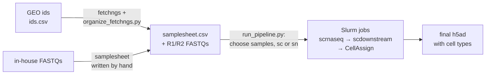

# Beyer's lab scRNA-seq pipeline

Takes list of single-cell/single-nuclei GEO ids or in-house FASTQs to a preprocessed AnnData with assigned cell types.

Works on in-house data and on public GEO datasets.

Built on nf-core/fetchngs, nf-core/scrnaseq (STARsolo) and nf-core/scdownstream (CellBender, decontX, scDblFinder), with CellAssign for cell types.

## Steps



1. `bash setup.sh <cache_dir>` (conda environment `scrnaseq` and our container images).
2. Fill in the TODOs in `preprocessing/config.yaml` and `public_data/config.yaml`
3. **Public data only:** download GEO studies with fetchngs and sort the FASTQs into one folder per GSE with a samplesheet → [public_data/README.md](public_data/README.md).
4. **Public and in-house data:** `python preprocessing/run_pipeline.py <samplesheet.csv> <outdir>`: choose the samples and sc/sn, then the steps run as Slurm jobs → [preprocessing/README.md](preprocessing/README.md).
5. **Result:** `<outdir>/results/final/<name>.h5ad`.

## Files

```
scrnaseq_pipeline/
├── setup.sh                  creates the conda environment, builds the container images
├── envs/                     conda environment scrnaseq (+ lock with exact versions)
├── containers/               custom images of CellBender, scDblFinder and decontX
├── public_data/              fetchs and organises public sc/sn datasets
└── preprocessing/            preprocess FASTQ files into final h5ad
```

## Versions

| Component | Version | Set in |
|---|---|---|
| [nf-core/fetchngs](https://nf-co.re/fetchngs) | 1.13.0 (commit `955c892`) | the `nextflow run` command in `public_data/README.md` |
| [nf-core/scrnaseq](https://nf-co.re/scrnaseq) | 4.2.0 (commit `3fc17b4`) | `SCRNASEQ` in `preprocessing/run_pipeline.py` |
| [nf-core/scdownstream](https://nf-co.re/scdownstream) | no release yet: commit `0048567589248aac5669ffd0151b8f6d15417804` on `dev` | `SCDOWNSTREAM` in `preprocessing/run_pipeline.py` |
| All other packages | exact versions | `envs/scrnaseq.lock.yml` |
| CellBender 0.4.0, scDblFinder 1.24.10, decontX (celda 1.26.0) | exact package versions | `containers/*/lock.txt` |

The other tools run in the containers of the nf-core modules, fixed by each pipeline version.
Every run records the versions it used: `results/*/pipeline_info/` of each pipeline, and `uns['pipeline']` of the final h5ad.

## Citation

If you use this pipeline, cite the nf-core pipelines it runs:

- nf-core/fetchngs (public data), <https://nf-co.re/fetchngs>: doi [10.5281/zenodo.5070524](https://doi.org/10.5281/zenodo.5070524)
- nf-core/scrnaseq, <https://nf-co.re/scrnaseq>: doi [10.5281/zenodo.3568187](https://doi.org/10.5281/zenodo.3568187)
- nf-core/scdownstream, <https://nf-co.re/scdownstream>: no release and no doi yet; give the commit from the table above
- the nf-core framework:
  > The nf-core framework for community-curated bioinformatics pipelines.
  > Philip Ewels, Alexander Peltzer, Sven Fillinger, Harshil Patel, Johannes Alneberg, Andreas Wilm, Maxime Ulysse Garcia, Paolo Di Tommaso & Sven Nahnsen.
  > Nat Biotechnol. 2020 Feb 13. doi: [10.1038/s41587-020-0439-x](https://doi.org/10.1038/s41587-020-0439-x).

The tools inside these pipelines (STAR, CellBender, decontX, scDblFinder, …) are listed with their citations in the `CITATIONS.md` of each pipeline.
